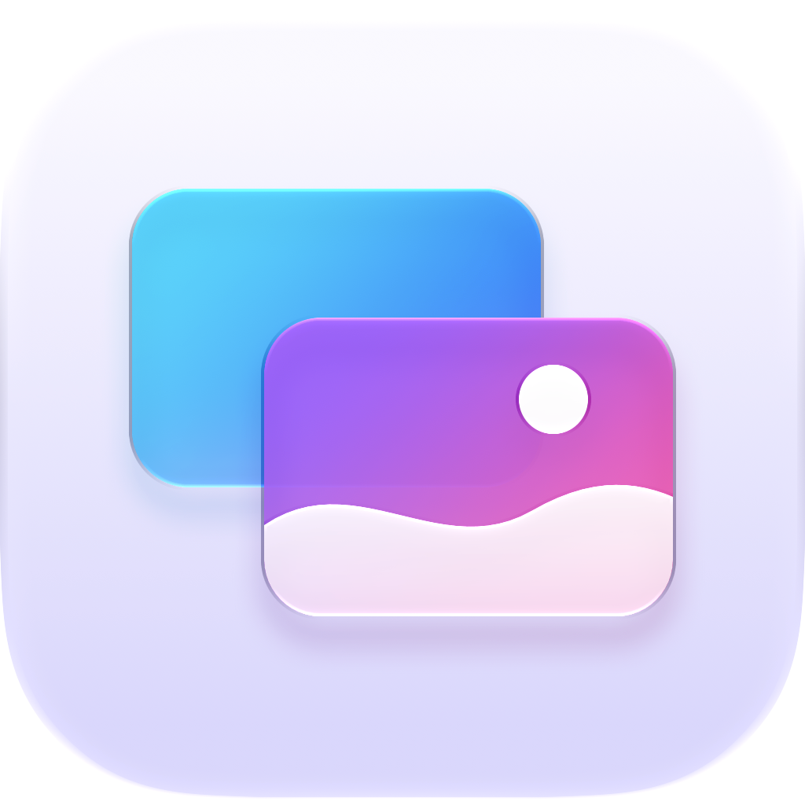

<div align="center">



# Loopwall

**专为 Apple Silicon Mac 打造的轻量级本地视频动态壁纸与多屏独立轮播应用**

[](#-下载与安装)
[](go.mod)
[](LICENSE)
[](.github/workflows/build.yml)
[](https://github.com/Lumiaqian/loopwall/releases)

原生 `LoopwallExtension` 壁纸扩展 · 多屏独立轮播与单屏固定 · Liquid Glass 液态玻璃界面 · 局域网双向互传 · Ed25519 签名自动更新

[下载最新版](https://github.com/Lumiaqian/loopwall/releases) · [核心功能](#-核心功能一览) · [操作与数据速查](#-常用操作与数据速查) · [下载与安装](#-下载与安装) · [项目架构](#-项目架构) · [开发与发版](#-本地开发与自动化发版)

</div>

---

Loopwall 使用 **Go（MyGO `v0.9.0`）原生界面** 管理本地视频资料库、播放规则与局域网共享，并由独立的 **Swift 6 墙纸扩展（`LoopwallExtension`）** 通过 `AVAssetReader → AVSampleBufferDisplayLayer → 远程 CAContext` 原生解码渲染。基于 [Phosphene `v1.11.4`](https://github.com/kageroumado/phosphene/tree/v1.11.4)（保留原 MIT 版权声明），面向 Apple Silicon 与 macOS 26+ 个人使用（当前已在 macOS 27.0.1 实机验证，详见 [真机验证状态](docs/VALIDATION.md)）。

## ✨ 核心功能一览

### 1. 原生系统壁纸扩展与多屏独立轮播
- **宿主解耦常驻播放**：在系统「墙纸设置」选中 **「Loopwall 轮播」** 后由系统宿主直接驱动播放；关闭管理窗口后保留菜单栏，完全退出管理端后桌面与锁屏壁纸仍继续无缝播放，并可在设置中开启登录启动。
- **静音无损画质与灵活切换规则**：视频全程静音、保留原片画质；支持「播完一遍切换」或自定义正整数秒「指定时长切换」（默认 `60` 秒，短片循环、长片到时切换）。
- **多屏独立与单屏固定**：各显示器依据 `CGDisplayCreateUUIDFromDisplayID` 稳定身份首次按列表周期均匀错开，随后独立续播（显示器插拔不重置其他屏幕，设置预览亦不推进桌面进度）；每块屏还可单独固定循环某一视频（显示器卡片「播放」菜单或资料库卡片「⋯ → 设为壁纸」）。
- **克制的电源与自愈策略**：无 Steam、创意工坊或全屏/遮挡暂停包袱，仅在系统休眠、显示器断开或表面不可见时挂起解码；「接电锁屏时保持亮屏」默认开启（仅在实际启用本墙纸、接电且锁屏时持有 `PreventUserIdleDisplaySleep`）；扩展卡住或静默时支持通过重启 `WallpaperAgent` 自动或手动重建表面。

### 2. 资料库管理与 Liquid Glass 界面
- **多渠道无损批量导入**：支持文件选择、直接将视频或文件夹拖入窗口（递归导入 MP4 / MOV / M4V 并跳过隐藏文件），以及命令行 `--import` 批量导入（管理端运行与否均可）；导入过程先复制到临时目录完成原生音视频轨验证、真实尺寸读取与缩略图生成，再通过原子 `catalog.json` 发布配置。
- **即开即播预览与安全清理**：预览窗口打开后先展示缩略图并在首帧解码后立即播放；删除视频仅移除新应用副本、不删源文件，并在确认扩展与原生读者全部释放句柄后再清理磁盘占用。
- **Liquid Glass 分层外观**：提供 `无 / 标准 / 极致` 三档液态玻璃效果、跟随系统 / 浅色 / 深色外观以及 `6` 组强调色（紫 / 蓝 / 粉 / 橙 / 绿 / 跟随系统）；界面文案、配色与排版 token 均受 `design_test.go` 与 [设计系统](docs/design/README.md) 约束。

### 3. 局域网共享与双 Mac 双向互传
- **一次配对、双向互通**：在「设置 → 局域网共享」开启「共享我的资料库」后，通过 Bonjour（`_loopwall._tcp`）与本地只读 HTTPS 服务发布资料库并显示一个 32 字符的配对码（8 组 4 字符，可一键「复制」）；另一台 Mac 在「附近的 Mac」输入一次配对码完成双向配对，即可互相浏览并无损拉取原片至本机资料库（列表掉线保留 `30` 秒防抖，传输完成后与对方离线无关）。
- **端到端安全约束与诊断**：使用本地 `0600` 自签名 TLS 证书和固定指纹校验、令牌仅存 SHA-256 摘要、连续输错 `5` 次作废配对码；配对码内含对方证书指纹，输入方先核对再发送任何内容，同名冒充和中间人会被拒绝，授权同时绑定双方证书，令牌泄露也不够用；兼容 0.1.x 的 6 位旧码，但默认拒绝，需在共享方手动打开「允许旧版 Loopwall 配对（不安全）」，这类配对会被标为不安全；缺少本地网络权限或 Bonjour 发布异常时直接提示原因与系统设置快捷入口并自动重试（排查详见 [局域网排查手册](docs/LAN-TROUBLESHOOTING.md)）。

### 4. Ed25519 签名自动更新与旧版平滑迁移
- **应用内签名更新（0.1.2+）**：通过 `MyGO plugins/updater` 每日自动或手动检查 GitHub Releases 最新版本，校验证书清单 `update-darwin-arm64.json` 与安装包 `loopwall-*.tar.gz` 的 Ed25519 签名后替换重启，并在新版首次启动时自动重注册壁纸扩展与重建 `WallpaperAgent`。
- **Phosphene Go 无痛迁移**：旧版 `Phosphene Go`（`local.lumiaqian.phosphenego`）升级后首次启动会自动把原片资料库与 `settings.json` / 共享配对记录迁入 Loopwall 容器（已有资料库不覆盖，旧目录重命名为 `catalog.migrated.json` 防止重复迁移；迁移后需在系统墙纸设置重新选中「Loopwall 轮播」并按需重开登录启动）。

---

## 📖 常用操作与数据速查

<details open>
<summary><strong>点击展开 / 收起全部对照</strong></summary>

### 日常操作与命令行入口
| 场景 / 入口 | 操作说明 |
|---|---|
| 导入视频 / 文件夹 | 点击「导入视频」，或直接拖放文件 / 文件夹进主窗口（支持 MP4、MOV、M4V） |
| 命令行批量导入 | 执行 `open -n -W "$HOME/Applications/Loopwall.app" --args --import "/path/a.mp4" "/path/b.mov"`。管理端已退出时，本次启动导入完成后自动退出，`-W` 等到导入结束；管理端正在运行时，参数交给它导入（`open` 启动的进程工作目录不一定是当前目录，路径请写绝对路径），`open` 立即返回，请先删除旧的 `import-result.json` 再等它出现。结果写入 `import-result.json`（`~/Library/Containers/local.lumiaqian.loopwall.extension/Data/Documents/`） |
| 单屏固定循环 | 显示器卡片「播放」菜单，或资料库卡片「⋯ → 设为壁纸」；解除后继续按播放列表轮播 |
| 局域网共享 | 「设置 → 局域网共享」启用共享获取配对码（复制后在另一台 Mac「附近的 Mac」粘贴）；需允许本地网络权限与防火墙传入连接 |
| 关闭窗口 / 彻底退出 | 关闭主窗口仅收起到菜单栏；菜单栏选「退出管理端（壁纸继续播放）」退出管理端，扩展继续播放 |
| 重建卡死壁纸表面 | 使用窗口提示的修复动作，或在退出管理端后执行 `killall -TERM WallpaperAgent` |

### 应用标识与本地数据目录
| 项目 / 路径 | 用途说明 |
|---|---|
| `local.lumiaqian.loopwall` / `local.lumiaqian.loopwall.extension` | 管理端与系统墙纸扩展 Bundle ID |
| `~/Library/Containers/local.lumiaqian.loopwall.extension/Data/Documents/` | 容器数据根目录（视频不会提交到 Git 仓库） |
| `└─ catalog.json` / `runtime.json` | Go 原子发布的资料库与播放规则配置 / 扩展每 5 秒同步的各屏运行进度 |
| `└─ videos/<UUID>/` & `extension.log` | 复制后的原片与 `thumbnail.jpg` 缩略图 / 有界运行日志 |
| `~/Library/Application Support/Loopwall/` | 管理端设置与共享状态目录（`settings.json`、`share.json`、`share-cert.pem`、`share-key.pem`） |

</details>

---

## 📦 下载与安装

1. 前往 [GitHub Releases](https://github.com/Lumiaqian/loopwall/releases) 下载最新的 `Loopwall-<version>-arm64.zip`（附 `.sha256` 校验文件；也可在 [GitHub Actions](https://github.com/Lumiaqian/loopwall/actions) 下载单次构建的 `Loopwall-arm64` 产物）。
2. 解压后将 `Loopwall.app` 拖入 `/Applications` 或 `~/Applications`。
3. **首次运行与系统接入（需要 Apple Silicon 与 macOS 26+）**：
   - 构建采用 ad-hoc 签名、未经 Apple 公证：首次打开如遇系统拦截，可在 **系统设置 → 隐私与安全性** 点击 **「仍要打开」**，或运行：
     ```sh
     xattr -dr com.apple.quarantine /Applications/Loopwall.app
     ```
   - 打开 `Loopwall.app` 导入视频后，点击 **「打开系统墙纸设置」** 并选择 **「Loopwall 轮播」** 应用到目标显示器；`0.1.2` 及以上版本后续可在应用内自动检查并更新（更多细节见 [使用说明](docs/USAGE.md)）。

---

## 🏗 项目架构

Go 主应用负责 UI 与配置写入，Swift 扩展与原生模块负责视频解码、墙纸宿主接入及硬件探测：

| 模块 / 文件 | 职责 |
|---|---|
| `main.go` / `views.go` / `look.go` / `widgets.go` | MyGO 主应用入口、菜单栏常驻、Liquid Glass 三档外观分层、资料库与播放列表视图 |
| `prefs.go` / `preview.go` / `sharing.go` / `nearby.go` / `recovery.go` / `update.go` | 用户偏好设置与迁移、系统播放器预览窗、局域网共享管理、`WallpaperAgent` 卡死恢复、应用内更新与扩展重注册 |
| [`internal/catalog`](internal/catalog) | 资料库导入校验、原子 `catalog.json` 发布、旧版 Phosphene Go 迁移与安全删除清理 |
| [`internal/platform`](internal/platform) | Swift 原生媒体信息探测、缩略图生成、稳定显示器 UUID 识别、Bonjour 浏览发布与 MyGO 桥接 |
| [`internal/share`](internal/share) | 局域网共享服务端 / 客户端（HTTPS + 配对码绑定证书指纹的双向 TLS 配对 + 令牌 + `Range` 原片拉取） |
| [`internal/release`](internal/release) & [`cmd/updatepack`](cmd/updatepack) | 为包含嵌入式 `.appex` 扩展的最终包体生成 Ed25519 签名更新归档与 `update-darwin-arm64.json` |
| [`LoopwallExtension`](LoopwallExtension) | 独立 Swift 6 墙纸扩展：系统接入、原生解码、多屏交错轮播、单屏固定、锁屏接电亮屏与几何恢复 |
| [`docs`](docs) | [跨语言契约](docs/ARCHITECTURE.md)、[使用说明](docs/USAGE.md)、[真机验证状态](docs/VALIDATION.md)、[局域网排查手册](docs/LAN-TROUBLESHOOTING.md)、[设计系统](docs/design/README.md) 与 [上游研究归档](docs/upstream) |

---

## 🛠 本地开发与自动化发版

已验证工具链：**Go `1.27.3`**、**Xcode `27.0`**、**MyGO `v0.9.0`**（需先安装 Xcode 命令行工具并完成首次启动配置；格式与静态检查依赖 Homebrew 的 `swiftformat` 与 `swiftlint`）。

### 本地常用命令
```sh
# 1. 运行全套测试（Go race tests、Swift 6 轮播/几何测试、JSON 双向契约测试、go vet）
scripts/test.sh

# 2. 校验原生桥接与代码格式规范
go tool mygo native check internal/platform
swiftformat --lint .
swiftlint lint LoopwallExtension internal/platform/swift/Sources/Platform tests

# 3. 本地构建带扩展的签名应用包（输出至 dist/darwin-arm64/Loopwall.app）
scripts/build-local.sh

# 4. 测试 + 构建并安装更新至 ~/Applications/Loopwall.app（自动重注册扩展并重建 WallpaperAgent）
scripts/install-local.sh
open "$HOME/Applications/Loopwall.app"
```

### GitHub Actions 流水线（`.github/workflows/build.yml`）
- **持续集成与打包**：每次推送 `main`、发起 PR、推动 `v*` 标签或手动触发时，在 `xcode-27` 运行器执行桥接校验、`scripts/test.sh`、`gofmt` / `swiftformat` / `swiftlint` 检查、调用 `scripts/build-local.sh` 并校验 `mygo.json` 与 `LoopwallExtension` 版本号一致性，最终打包上传 `Loopwall-<version>-arm64.zip` 与 `.sha256` 产物。
- **标签签名与自动发版**：推送 `v*` 标签时额外使用仓库机密 `MYGO_UPDATER_PRIVATE_KEY` 运行 `cmd/updatepack` 为含扩展的完整包体签名（生成 `loopwall-*.tar.gz` 与 `update-darwin-arm64.json`），从 `CHANGELOG.md` 提取对应版本更新日志并发布 GitHub Release。

### 来源与许可
- **上游基线**：基于 [kageroumado/phosphene](https://github.com/kageroumado/phosphene)（基线提交 `cee21cef52380505d3593872ec53c1b56dc54e6e`，对应 Phosphene `v1.11.4`）。
- **框架与许可**：界面由 [MyGO](https://github.com/egoist/mygo) `v0.9.0` 驱动；[LICENSE](LICENSE) 保留原作者 MIT 声明并在构建时随本地应用一并打包（`Contents/Resources/LICENSE-Phosphene.txt`）。
