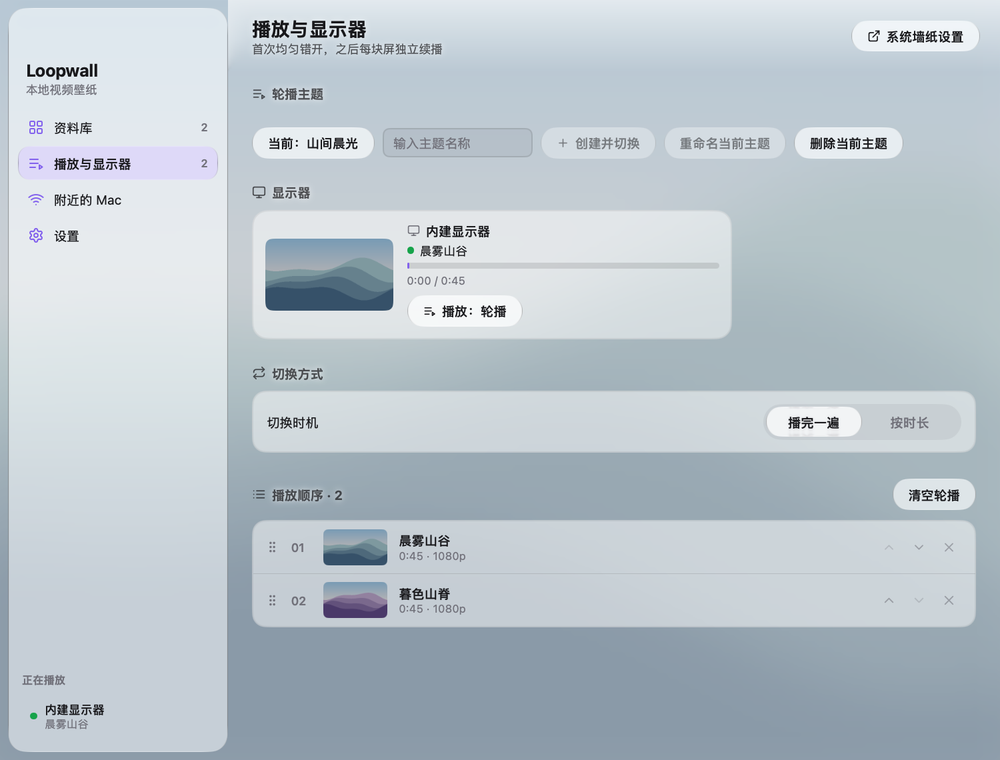
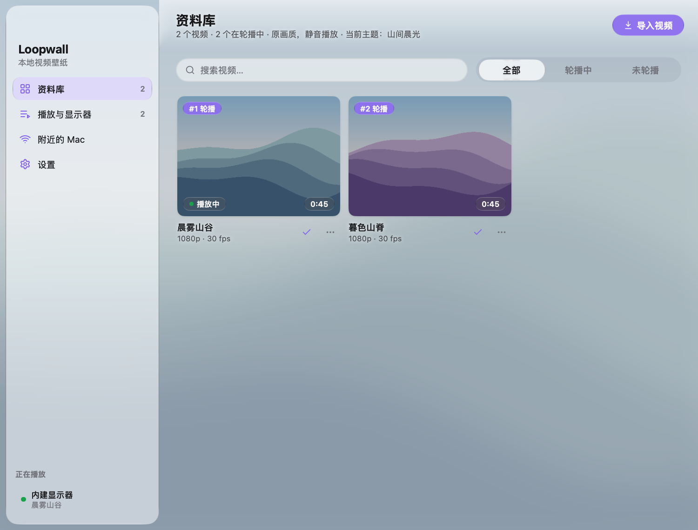

<div align="center">


# Loopwall

**专为 Apple Silicon Mac 打造的轻量级本地视频动态壁纸与多屏独立轮播应用**

[](#-下载与安装)
[](go.mod)
[](LICENSE)
[](.github/workflows/build.yml)
[](https://github.com/Lumiaqian/loopwall/releases)

[](https://awesomemygo.dev/apps/loopwall)

原生 `LoopwallExtension` 壁纸扩展 · 多主题独立轮播与单屏固定 · APFS 克隆无损导入 · Liquid Glass 界面 · 局域网短码互传 · Ed25519 自动更新

[下载最新版](https://github.com/Lumiaqian/loopwall/releases) · [核心功能](#-核心功能一览) · [操作与数据速查](#-常用操作与数据速查) · [下载与安装](#-下载与安装) · [项目架构](#-项目架构) · [开发与发版](#-本地开发与自动化发版)

</div>

---

Loopwall 使用 **Go（[MyGO](https://github.com/egoist/mygo) `v0.10.0` + [`mygo-ui-sdk`](https://github.com/Lumiaqian/mygo-ui-sdk)）原生界面** 管理本地视频资料库、多主题轮播规则与局域网共享，并由独立的 **Swift 6 墙纸扩展（`LoopwallExtension`）** 通过 `AVAssetReader → AVSampleBufferDisplayLayer → 远程 CAContext` 原生解码渲染。基于 [Phosphene `v1.11.4`](https://github.com/kageroumado/phosphene/tree/v1.11.4)（保留原 MIT 版权声明），面向 Apple Silicon 与 macOS 26+ 个人使用（当前已在 macOS 27.0.1 实机验证，详见 [真机验证状态](docs/VALIDATION.md)）。

<table>
  <tr>
    <td width="50%" align="center">
      
      <br />
      <sub><strong>播放与显示器</strong> · 多主题轮播管理、显示器实时状态与切换规则</sub>
    </td>
    <td width="50%" align="center">
      
      <br />
      <sub><strong>视频资料库</strong> · 实时搜索筛选、轮播序号标记与原画质静音播放</sub>
    </td>
  </tr>
</table>

---

## ✨ 核心功能一览

### 1. 原生系统壁纸扩展、多主题与多屏独立轮播
- **宿主解耦常驻播放**：在系统「墙纸设置」选中 **「Loopwall 轮播」** 后由系统宿主直接驱动播放；关闭主窗口仅收起到菜单栏，完全退出管理端后桌面与锁屏壁纸仍无缝续播，并支持开启登录启动。
- **多轮播主题自由切换**：在「播放与显示器」可创建、重命名、删除和切换多套轮播主题；每套主题独立维护选片与播放顺序，删除主题不删资料库视频，重启自动沿用上次主题。
- **多屏独立与单屏固定**：各显示器按 `CGDisplayCreateUUIDFromDisplayID` 稳定身份首次均匀错开，随后独立续播（插拔屏幕不重置其他屏，打开预览也不推进桌面进度）；任意屏幕均可单独固定循环指定视频，切换主题时固定屏幕保持不变。
- **无损静音与灵活切换**：全程静音、保留原片画质；支持「播完一遍」或「按时长」切换（内置 `30 秒 / 1 分钟 / 5 分钟 / 15 分钟` 预设及自定义正整数秒）。
- **省电模式与自愈恢复**：
  - 支持在「设置 → 通用」或菜单栏直接开关 **「省电模式」**（默认关闭），在电池供电、低电量模式或机身过热时自动暂停壁纸；同时在休眠、显示器断开或表面不可见时挂起解码。
  - **「接电锁屏时保持亮屏」** 默认开启（仅在实际启用本墙纸、接电且锁屏时持有 `PreventUserIdleDisplaySleep`）。
  - **「修复壁纸」** 会先核对正式版扩展登记（如系统误登记废纸篓旧副本，仅注销该旧副本登记，单次操作最多重启一次 `WallpaperAgent`），并逐屏核对恢复进度，分别提示休眠、锁屏、省电暂停或待检查屏幕。

### 2. 资料库管理、APFS 克隆导入与 Liquid Glass 界面
- **APFS 克隆无损导入**：支持文件选择、拖入视频或文件夹（后台递归扫描 MP4 / MOV / M4V 并实时展示导入进度）以及命令行 `--import` 批量导入。导入本地视频时**优先使用 APFS 克隆**（不支持时自动回退复制），相同内容在资料库内共用存储空间，各条目仍可独立加入不同主题或删除。
- **高效检索与快捷预览**：资料库支持按名称/分辨率搜索与「全部 / 轮播中 / 未轮播」筛选、双击重命名与卡片右键菜单；播放顺序支持拖拽排序及「全部加入轮播」「清空轮播」。独立视频预览窗打开即显缩略图、首帧解码即播，提供悬停玻璃控制条与纯键盘进度定位。
- **权限恢复与安全清理**：当 macOS 拒绝资料库访问时，可按引导重选「原壁纸资料库」恢复已有列表，避免误迁移覆盖数据；删除视频仅移除应用内副本、不删源文件，并在确认扩展与播放器均释放句柄后再回收空间。
- **Liquid Glass 分层外观**：提供 `无 / 标准 / 极致` 三档液态玻璃效果、跟随系统 / 浅色 / 深色外观以及 `6` 组强调色（紫 / 蓝 / 粉 / 橙 / 绿 / 跟随系统）；全应用与托盘菜单统一简体中文，界面配色与排版 token 受 `design_test.go` 与 [设计系统](docs/design/README.md) 约束。

### 3. 局域网共享与双 Mac 短码双向互传
- **核对短码、一次配对双向互通**：在「设置 → 局域网共享」开启「共享我的资料库」后，通过 Bonjour（`_loopwall._tcp`）与本地只读 HTTPS 服务发布资料库。在另一台 Mac 的「附近的 Mac」选中对方并点「核对短码配对」，双机核对短码后均点击「两边一致」即可完成双向配对，互相浏览并无损拉取原片（列表掉线保留 `30` 秒防抖，传输完成后与对方离线无关）。
- **蓝牙按需初始化与端到端校验**：附近设备配对组件仅在开启局域网共享或进入「附近的 Mac」时才按需初始化。传输层采用本地 `0600` 自签名 TLS 证书与双向指纹绑定，令牌仅存 SHA-256 摘要，一次性配对码/邀请仅可成功兑换一次且连续输错 `5` 次作废；兼容旧版 6 位配对码但默认拒绝（需共享方手动开启并标为不安全）。权限缺失或发布异常时直接提示原因与系统设置入口（排查详见 [局域网排查手册](docs/LAN-TROUBLESHOOTING.md)）。

### 4. Ed25519 签名自动更新与旧版平滑迁移
- **应用内签名更新（0.1.2+）**：通过 `MyGO plugins/updater` 每日自动或手动检查 GitHub Releases 最新版本，校验 `update-darwin-arm64.json` 与 `loopwall-*.tar.gz` 的 Ed25519 签名后替换重启，并在新版首次启动时自动重注册壁纸扩展与重建 `WallpaperAgent`。
- **Phosphene Go 无痛迁移**：旧版 `Phosphene Go`（`local.lumiaqian.phosphenego`）升级后首次启动会自动将原片资料库、`settings.json` 与共享配对记录迁入 Loopwall 容器（已有资料库不覆盖，旧目录重命名为 `catalog.migrated.json` 防止重复迁移）。

---

## 📖 常用操作与数据速查

<details open>
<summary><strong>点击展开 / 收起全部对照</strong></summary>

### 日常操作与命令行入口
| 场景 / 入口 | 操作说明 |
|---|---|
| 导入视频 / 文件夹 | 点击「导入视频」（或 `⌘O`），或直接拖放视频 / 文件夹进主窗口（支持 MP4、MOV、M4V，优先 APFS 克隆） |
| 命令行批量导入 | 执行 `open -n -W "$HOME/Applications/Loopwall.app" --args --import "/path/a.mp4" "/path/b.mov"`（请使用绝对路径）。管理端未运行时导入完成即自动退出；运行中则转交导入并立刻返回（建议先删旧的 `import-result.json` 再等待新结果写入容器 `Documents/`） |
| 轮播主题切换 | 「播放与显示器 → 轮播主题」创建、重命名、删除或切换主题；删除主题不会删除资料库视频 |
| 单屏固定循环 | 显示器卡片「播放」菜单，或资料库卡片「⋯ → 设为壁纸」；解除后继续按当前主题轮播 |
| 局域网共享与配对 | 「设置 → 局域网共享」开启共享后，在另一台 Mac「附近的 Mac」选中对方并「核对短码配对」（旧版兼容亦支持复制 32 位配对码粘贴）；需允许本地网络、蓝牙（附近发现）与防火墙传入连接 |
| 关闭窗口 / 退出管理端 | 关闭主窗口仅收起到菜单栏；菜单栏可快速切换「省电模式」，选「退出管理端（壁纸继续播放）」后扩展仍持续播放 |
| 修复卡死壁纸 | 点击界面提示的「修复壁纸」核对扩展登记并逐屏检查恢复，或在退出管理端后执行 `killall -TERM WallpaperAgent` |

### 快捷键对照
| 范围 | 快捷键 | 功能 |
|---|---|---|
| 主窗口 | `⌘1` / `⌘2` / `⌘3` / `⌘4`（或 `⌘,`） | 切换至「资料库 / 播放与显示器 / 附近的 Mac / 设置」 |
| 主窗口 | `⌘O` / `⌘F` | 导入视频 / 聚焦资料库搜索框 |
| 视频预览窗 | `Space` / `Esc` | 播放或暂停 / 关闭预览窗 |
| 视频预览窗 | `←` / `→` / `Tab` | 切换上 / 下一个视频 / 聚焦进度条并用方向键定位 |

### 应用标识与本地数据目录
| 项目 / 路径 | 用途说明 |
|---|---|
| `local.lumiaqian.loopwall` / `local.lumiaqian.loopwall.extension` | 管理端与系统墙纸扩展 Bundle ID |
| `~/Library/Containers/local.lumiaqian.loopwall.extension/Data/Documents/` | 容器数据根目录（视频不提交至 Git 仓库） |
| `└─ catalog.json` / `runtime.json` | Go 原子发布的资料库、轮播主题与播放规则 / 扩展同步的各屏运行状态 |
| `└─ videos/<UUID>/` & `extension.log` | APFS 克隆或复制后的原片与 `thumbnail.jpg` 缩略图 / 有界运行日志 |
| `~/Library/Application Support/Loopwall/` | 管理端设置与共享状态目录（`settings.json`、`share.json`、`share-cert.pem`、`share-key.pem`） |

</details>

---

## 📦 下载与安装

1. 前往 [GitHub Releases](https://github.com/Lumiaqian/loopwall/releases) 下载最新的 `Loopwall-<version>-arm64.zip`（附 `.sha256` 校验文件；也可在 [GitHub Actions](https://github.com/Lumiaqian/loopwall/actions) 下载单次构建的 `Loopwall-arm64` 产物）。
2. 解压后将 `Loopwall.app` 拖入 `/Applications` 或 `~/Applications`。
3. 打开 `Loopwall.app` 导入视频，点击 **「打开系统墙纸设置」** 并选择 **「Loopwall 轮播」** 应用到目标显示器；`0.1.2` 及以上版本后续可在应用内自动检查并更新（更多细节见 [使用说明](docs/USAGE.md)）。

> [!NOTE]
> **系统要求与首次打开说明（Apple Silicon · macOS 26+）**
> - 官方 Releases 由 GitHub Actions 使用固定的自签名证书统一签名主应用与 `LoopwallExtension.appex`（版本更新可保持一致的签名身份；未配置证书机密的自定义构建会退回 ad-hoc 签名）。
> - 由于自签名证书未经 Apple 公证，首次打开若遇系统拦截，请在 **系统设置 → 隐私与安全性** 点击 **「仍要打开」**，或执行：
>   ```sh
>   xattr -dr com.apple.quarantine /Applications/Loopwall.app
>   ```

---

## 🏗 项目架构

Go 主应用负责 UI、主题与配置写入，Swift 扩展与原生模块负责视频解码、墙纸宿主接入及硬件探测：

| 模块 / 文件 | 职责 |
|---|---|
| [`main.go`](main.go) / [`views.go`](views.go) / [`look.go`](look.go) / [`widgets.go`](widgets.go) | MyGO 主应用入口、菜单栏常驻、全局快捷键、Liquid Glass 三档外观分层与通用组件 |
| [`view_library.go`](view_library.go) / [`view_playlist.go`](view_playlist.go) / [`view_settings.go`](view_settings.go) | 资料库搜索筛选、多主题播放顺序与显示器控制、偏好设置界面 |
| [`prefs.go`](prefs.go) / [`preview.go`](preview.go) / [`sharing.go`](sharing.go) / [`nearby.go`](nearby.go) / [`nearby_pairing.go`](nearby_pairing.go) / [`recovery.go`](recovery.go) / [`repair.go`](repair.go) / [`update.go`](update.go) | 偏好迁移、原生播放器预览窗、局域网共享与附近短码配对、扩展登记核对与 `WallpaperAgent` 恢复、应用内签名更新 |
| [`internal/catalog`](internal/catalog) | 资料库 APFS 克隆导入校验、多主题原子 `catalog.json` 发布、旧版 Phosphene Go 迁移与安全删除清理 |
| [`internal/platform`](internal/platform) | Swift 原生媒体探测、缩略图生成、稳定显示器 UUID、Bonjour 与 Nearby 附近发现桥接 |
| [`internal/share`](internal/share) | 局域网共享服务端 / 客户端（HTTPS + 证书指纹双向 TLS 配对 + 令牌校验 + `Range` 原片拉取） |
| [`internal/release`](internal/release) & [`cmd/updatepack`](cmd/updatepack) | 为含嵌入式 `.appex` 扩展的完整包体生成 Ed25519 签名更新归档与 `update-darwin-arm64.json` |
| [`LoopwallExtension`](LoopwallExtension) | 独立 Swift 6 墙纸扩展：系统接入、原生解码、多屏交错轮播、单屏固定、省电暂停、锁屏亮屏与几何恢复 |
| [`docs`](docs) | [跨语言契约](docs/ARCHITECTURE.md)、[使用说明](docs/USAGE.md)、[真机验证状态](docs/VALIDATION.md)、[局域网排查手册](docs/LAN-TROUBLESHOOTING.md)、[设计系统](docs/design/README.md) 与 [上游研究归档](docs/upstream) |

---

## 🛠 本地开发与自动化发版

已验证工具链：**Go `1.27`**（`go.mod` `1.27.4`）、**Xcode `27.0`**、**MyGO `v0.10.0`**、**`mygo-ui-sdk v0.1.1`**（需先安装 Xcode 命令行工具并完成首次启动配置；格式与静态检查依赖 Homebrew 的 `swiftformat` 与 `swiftlint`）。

### 本地常用命令
```sh
# 1. 运行全套测试（Go race tests、Swift 6 轮播/几何测试、JSON 双向契约测试、go vet）
scripts/test.sh

# 2. 校验原生桥接与代码格式规范
go tool mygo native check internal/platform
swiftformat --lint .
swiftlint lint LoopwallExtension internal/platform/swift/Sources/Platform tests

# 3. 本地构建带扩展的签名应用包（输出至 dist/darwin-arm64/Loopwall.app）
scripts/build-local.sh

# 4. 测试 + 构建并安装更新至 ~/Applications/Loopwall.app（自动重注册扩展并重建 WallpaperAgent）
scripts/install-local.sh
open "$HOME/Applications/Loopwall.app"
```

### GitHub Actions 流水线（[`.github/workflows/build.yml`](.github/workflows/build.yml)）
- **持续集成与打包**：每次推送 `main`、发起 PR、推送 `v*` 标签或手动触发时，在 `xcode-27` 运行器依次执行原生桥接检查、`scripts/test.sh`、`gofmt` / `swiftformat` / `swiftlint`、`staticcheck`、`govulncheck`，调用 `scripts/build-local.sh` 并校验 `mygo.json` 与 `LoopwallExtension` 版本号一致性，最终打包上传 `Loopwall-<version>-arm64.zip` 与 `.sha256`。
- **代码签名**：仓库配置 `MACOS_CERTIFICATE`、`MACOS_CERTIFICATE_PASSWORD`、`MACOS_SIGNING_IDENTITY` 机密时，会以固定证书同时签名主应用与 `LoopwallExtension.appex`，并校验 `designated requirement` 不退回 `cdhash`；未配置时退回 ad-hoc 签名。本地亦可通过 `MACOS_SIGNING_IDENTITY="..." scripts/build-local.sh` 使用固定证书。
- **自动发版**：推送 `v*` 标签时额外使用 `MYGO_UPDATER_PRIVATE_KEY` 运行 `cmd/updatepack` 为含扩展的完整包体签名（生成 `loopwall-*.tar.gz` 与 `update-darwin-arm64.json`），从 `CHANGELOG.md` 提取对应版本说明并发布 GitHub Release。

---

## 📄 来源与许可

- **上游基线**：基于 [kageroumado/phosphene](https://github.com/kageroumado/phosphene)（基线提交 `cee21cef52380505d3593872ec53c1b56dc54e6e`，对应 Phosphene `v1.11.4`）。
- **框架与许可**：界面由 [MyGO](https://github.com/egoist/mygo) `v0.10.0` 驱动；本项目采用 [MIT License](LICENSE)，保留原作者 MIT 声明并在构建时一并打包（`Contents/Resources/LICENSE-Phosphene.txt`）。
